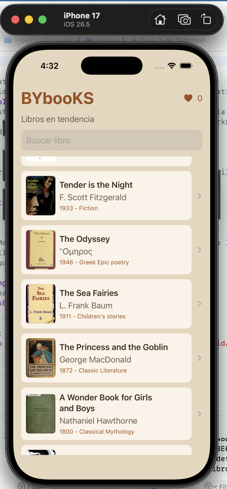
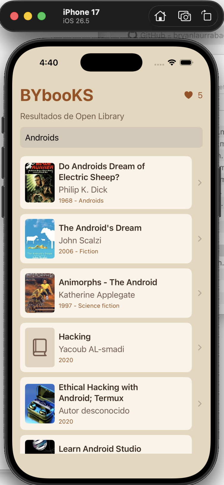
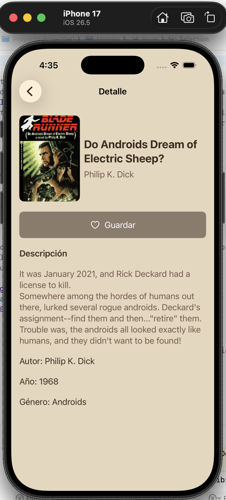
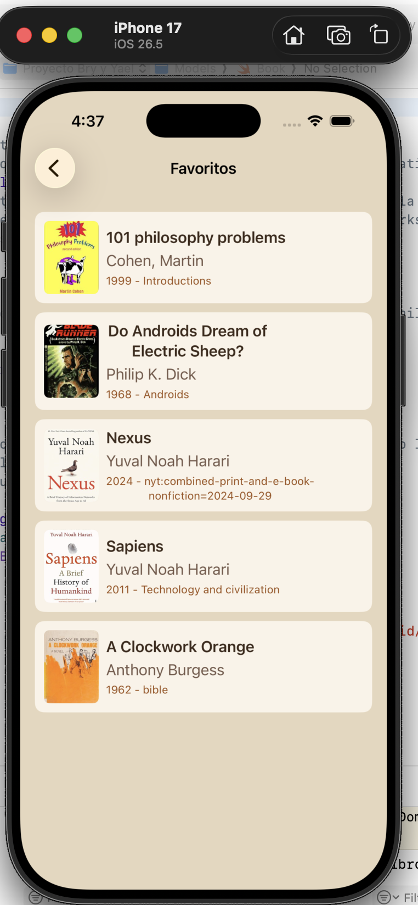

# BYbooKS — Gestor Personal de Libros

Aplicación iOS para descubrir libros, buscarlos en Open Library, ver su detalle y guardarlos como favoritos en el dispositivo. Incluye un **módulo de apartados** (piloto) para una librería de barrio: inventario del local, folios y dos perfiles. Ver [`docs/modulo-apartados.md`](docs/modulo-apartados.md).

**Equipo 8**

- Bryan Ricardo Laurrabaquio Ramírez
- Yael Alam González Prospero

---

## Descripción

Encontrar un libro y llevar el control de los que nos interesan suele implicar varias aplicaciones o cuentas. BYbooKS resuelve esto en una sola pantalla: muestra libros en tendencia, permite buscar en toda la base de Open Library por título o autor, y guarda los libros elegidos de forma local, sin crear una cuenta.

## Funcionalidades

- **Catálogo de inicio:** al abrir la app se muestran 10 libros del tema *classics* de Open Library. Al jalar la lista hacia abajo se cambian por 10 libros de otro tema elegido al azar.
- **Búsqueda local:** al escribir en el campo de búsqueda se filtran, por título o autor, los libros ya descargados.
- **Búsqueda en Open Library:** al presionar *Buscar* en el teclado se consulta toda la base de datos de Open Library (hasta 50 resultados).
- **Detalle del libro:** portada, título, autor, año de primera publicación, género y descripción. La descripción se pide aparte a Open Library; si no existe se muestra "Descripción no disponible.".
- **Favoritos persistentes:** se guardan y se quitan desde el botón *Guardar / Guardado* del detalle. Se almacenan con SwiftData y siguen ahí al cerrar y volver a abrir la app. La lista se consulta desde el botón del corazón en Inicio, que muestra el contador.
- **Estados de la interfaz:** cargando, contenido, sin resultados y error (con botón *Reintentar*), tanto en el catálogo como en la búsqueda. La pantalla de favoritos muestra un mensaje cuando está vacía.
- **Datos faltantes:** si un libro no trae portada, año, género o descripción, se muestra un texto o ícono de reemplazo en lugar de dejar el espacio vacío.
- **Accesibilidad:** etiquetas de VoiceOver en portadas, botón de guardar y acceso a favoritos.
- **Navegación:** dos pestañas, *Libros* (catálogo, búsqueda y favoritos) y *Apartados*.
- **Módulo de apartados (piloto):** la pestaña *Apartados* muestra los folios y el inventario del local. Un folio se puede apartar, entregar, cancelar o vencer, y siempre se cumple *Disponibles = Existencia física − Apartados activos*. Hay dos perfiles, vendedor y encargada (solo la encargada ajusta existencias), y las tarjetas de los libros muestran *Disponibles: N* o *Sin stock*. Es un caso simulado (*Página de Barrio*); el detalle, los supuestos y los límites están en [`docs/modulo-apartados.md`](docs/modulo-apartados.md).

## Tecnologías

| Tecnología | Uso |
|---|---|
| Swift y SwiftUI | Lenguaje e interfaz |
| Observation (`@Observable`) | Estado compartido y ViewModels |
| SwiftData | Persistencia local de favoritos, inventario y folios |
| URLSession + `async/await` | Consumo de la API |
| Open Library Search API | Búsqueda de libros (`openlibrary.org/search.json`) |
| Open Library Works API | Descripción del libro (`openlibrary.org/works/{id}.json`) |
| Open Library Covers API | Portadas (`covers.openlibrary.org`) |
| XCTest y Swift Testing | Pruebas unitarias |

## Requisitos

- macOS con **Xcode 26** o posterior (el proyecto usa `IPHONEOS_DEPLOYMENT_TARGET = 26.5`).
- Simulador de iOS 26.5 o un iPhone con iOS 26.5 o posterior.
- Conexión a internet para el catálogo, la búsqueda, las portadas y las descripciones.
- No se necesitan gestores de dependencias: el proyecto no usa paquetes de terceros.

## Instalación y configuración

1. Clonar el repositorio:

   ```bash
   git clone https://github.com/bryanlaurrabaquio/Proyecto-AJBooKS-Bryan-Yael.git
   cd Proyecto-AJBooKS-Bryan-Yael
   ```

2. Abrir `Proyecto Bry y Yael.xcodeproj` con Xcode.
3. Esperar a que Xcode termine de indexar el proyecto.
4. Para ejecutar en un iPhone físico, en *Signing & Capabilities* elegir tu propio *Team* (el bundle identifier actual es `fca.Proyecto-Bry-y-Yael`; si Xcode lo rechaza, cámbialo por uno propio). En el simulador no hace falta.

## Ejecución

1. En la barra superior de Xcode elegir el esquema **Proyecto Bry y Yael** y un simulador de iPhone con iOS 26.5 o superior.
2. Presionar **Run** (⌘R).

### Pruebas

Presionar **⌘U** en Xcode, o desde la terminal:

```bash
xcodebuild test \
  -project "Proyecto Bry y Yael.xcodeproj" \
  -scheme "Proyecto Bry y Yael" \
  -destination "platform=iOS Simulator,name=<nombre-del-simulador>"
```

Las pruebas unitarias no usan la red real: reemplazan `URLSession` con un cliente falso y usan una base de SwiftData en memoria. Detalle en [`docs/documentacion-tecnica.md`](docs/documentacion-tecnica.md#6-pruebas).

## Configuración de servicios externos

La app usa únicamente **Open Library**, una API pública que **no requiere cuenta, API key ni token**. Por eso no hay credenciales en el repositorio ni archivos de configuración que crear.

Open Library pide a las aplicaciones identificarse con un `User-Agent`; la app envía `BYbooKS/1.0 (proyecto educativo)` (en `Services/BookService.swift`). Si se publicara la app, conviene agregar un correo de contacto en ese valor.

## Capturas de pantalla

| Inicio | Búsqueda en Open Library |
|---|---|
|  |  |

| Detalle | Favoritos |
|---|---|
|  |  |

> Estas capturas son anteriores al módulo de apartados: todavía no hay capturas de la pestaña *Apartados* ni de la disponibilidad en el detalle.

## Estructura del repositorio

```
.
├── Proyecto Bry y Yael/            Código de la app
│   ├── Models/                     Book, BookStore, FavoriteBook, LoadState, DTOs de Open Library; apartados: ReservationStore, Reservation, InventoryItem, StockSummary, UserRole, ProfileStore
│   ├── Services/                   OpenLibraryService, FavoritesService, errores; apartados: ReservationRepository (memoria y SwiftData)
│   ├── ViewModels/                 BookListViewModel, BookDetailViewModel, FavoritesViewModel; apartados: BookStockViewModel, ReservationsViewModel, InventoryViewModel
│   ├── Views/                      RootView (pestañas), ContentView, SecondView, FavoritesView, ReservationsView y Components/ (BookRow, SearchField, Theme, StockSection…)
│   └── Proyecto_Bry_y_YaelApp.swift
├── Proyecto Bry y YaelTests/       Pruebas unitarias
├── Proyecto Bry y YaelUITests/     Plantilla de pruebas de interfaz (sin casos propios)
├── docs/                           Documentación (ver abajo)
└── Proyecto Bry y Yael.xcodeproj
```

## Documentación

| Documento | Contenido |
|---|---|
| [`docs/documentacion-tecnica.md`](docs/documentacion-tecnica.md) | Arquitectura, networking, persistencia, decisiones técnicas y limitaciones conocidas (versión final) |
| [`docs/modulo-apartados.md`](docs/modulo-apartados.md) | Módulo de apartados: reglas, perfiles, estados del folio, supuestos, metas de la presentación y pruebas |
| [`docs/entrega-final.md`](docs/entrega-final.md) | Revisión del repositorio, pruebas ejecutadas y versión de entrega |
| [`docs/navigation-and-state.md`](docs/navigation-and-state.md) | Práctica 4: navegación y organización del estado (actualizado a la versión final) |
| [`docs/mvvm-investigacion-arquitectura.md`](docs/mvvm-investigacion-arquitectura.md) | Práctica 5: investigación de MVVM y cómo se resolvieron sus dudas |
| [`docs/mvvm-refactorizacion.md`](docs/mvvm-refactorizacion.md) | Práctica 5: refactorización a MVVM y estado de sus pendientes |

## Diseño inicial (wireframes)

Los wireframes de [`docs/wireframes/`](docs/wireframes/) corresponden al **diseño inicial** del proyecto, con una barra de pestañas *Inicio / Buscar / Mis libros*. La versión final tiene dos pestañas distintas, *Libros* y *Apartados*: la búsqueda está en la pantalla de Inicio de *Libros* y los favoritos se abren con el botón del corazón. Las capturas de arriba muestran la pestaña *Libros* sin el módulo de apartados.

## Limitaciones conocidas

Resumen; la lista completa está en la [documentación técnica](docs/documentacion-tecnica.md#8-limitaciones-conocidas).

- Sin conexión, los favoritos se ven (título, autor, año y género) pero no sus portadas, y su descripción no se puede cargar.
- Desde la pantalla de Favoritos no se puede quitar un libro: se hace desde su detalle.
- La búsqueda trae como máximo 50 resultados y no tiene paginación.
- Open Library no tiene un campo de género, solo etiquetas; la app muestra la primera que esté en su lista de géneros conocidos y, si no hay ninguna, no muestra género.
- La app fuerza el tema claro y solo tiene textos en español.
- Las pruebas de interfaz (`UITests`) son la plantilla de Xcode; la lógica está cubierta con pruebas unitarias.
- Apartados: el inventario y los folios viven en un solo dispositivo (sin sincronización), los perfiles no tienen contraseña y el plazo de vencimiento (3 días) es un supuesto por confirmar. Lista completa en [`docs/modulo-apartados.md`](docs/modulo-apartados.md#8-supuestos-y-limitaciones).
