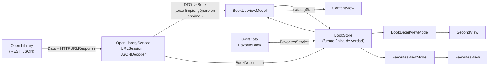

# Arquitectura de BYbooKS

Este documento describe cómo está organizada la app en su versión actual. Los detalles de la API
están en [NETWORKING.md](NETWORKING.md) y los de almacenamiento local en [PERSISTENCE.md](PERSISTENCE.md).

## 1. Visión general

BYbooKS sigue el patrón **MVVM** visto en clase, con una **fuente única de verdad** (`BookStore`)
compartida por todas las pantallas y una capa de **servicios** que aísla la red y la persistencia.

| Capa | Responsabilidad | No debe |
|---|---|---|
| **Model** | Representar los datos (`Book`, `BookDescription`, `FavoriteBook`) y el estado compartido (`BookStore`). | Dibujar interfaz. |
| **ViewModel** | Preparar el estado de cada pantalla (textos, listas filtradas, mensajes) y coordinar acciones. | Importar SwiftUI ni hacer peticiones HTTP directamente. |
| **View** | Dibujar el estado y avisar de las acciones del usuario. | Filtrar, decidir reglas o conocer la API. |
| **Service** | Hablar con Open Library (`URLSession`) y con SwiftData; transformar y limpiar los datos. | Conocer las vistas. |

## 2. Organización de carpetas

```
Proyecto Bry y Yael/
├── Proyecto_Bry_y_YaelApp.swift      Punto de entrada: SwiftData, BookStore y caché de imágenes
├── Assets.xcassets/                   Paleta de colores (BY*.colorset), AccentColor, AppIcon
├── Models/
│   ├── Book.swift                     Libro (id, título, autor, año, género, portada, edición)
│   ├── BookDescription.swift          Descripción (español / otro idioma / no disponible) y su estado
│   ├── BookStore.swift                Fuente única de verdad: catálogo, descripciones y favoritos
│   ├── FavoriteBook.swift             Modelo persistente de SwiftData (@Model)
│   ├── LoadState.swift                Estados del catálogo: idle, loading, content, empty, error
│   ├── OpenLibraryDTO.swift           Modelos Decodable de la API y su conversión a Book
│   └── Book+Samples.swift             Datos y servicios falsos para vistas previas (solo DEBUG)
├── Services/
│   ├── BookService.swift              OpenLibraryService: búsqueda y descripciones (URLSession)
│   ├── BookServiceError.swift         Errores de red con mensajes en español
│   ├── FavoritesService.swift         Favoritos con SwiftData y versión en memoria
│   ├── OpenLibraryCovers.swift        URLs de portadas (Covers API)
│   ├── TextSanitizer.swift            Limpieza de texto (HTML, Markdown, codificación, espacios)
│   ├── LanguageDetector.swift         Detección de idioma con NaturalLanguage
│   └── SubjectGenreMapper.swift       Temas de Open Library -> género en español
├── ViewModels/
│   ├── BookListViewModel.swift        Inicio: catálogo, búsqueda, favoritos y resúmenes
│   ├── BookDetailViewModel.swift      Detalle: guardado y descripción completa
│   ├── FavoritesViewModel.swift       Favoritos: lista, vacío y descripciones
│   └── DescriptionPresentation.swift  Qué texto de descripción ve la tarjeta y el detalle
└── Views/
    ├── ContentView.swift              Pantalla 1: Inicio
    ├── SecondView.swift               Pantalla 2: Detalle
    ├── FavoritesView.swift            Pantalla 3: Favoritos
    ├── Components/                    BookRow (tarjeta), BookCoverView, FavoriteToggleButton,
    │                                  SearchField, StatusMessageView
    └── Theme/Palette.swift            Paleta, medidas y estilos de botón

Proyecto Bry y YaelTests/              Pruebas unitarias (XCTest y Swift Testing)
Proyecto Bry y YaelUITests/            Pruebas de interfaz (XCUITest)
docs/                                  Documentación técnica e histórica
```

El proyecto usa *carpetas sincronizadas* de Xcode: cualquier archivo `.swift` que se agregue a estas
carpetas se incluye automáticamente en su target, sin editar el `.pbxproj`.

### Identificadores internos que se conservan

El nombre comercial es **BYbooKS** (`CFBundleDisplayName`), pero se conservan a propósito:

| Identificador | Valor | Por qué no se cambia |
|---|---|---|
| Target y producto | `Proyecto Bry y Yael` | Renombrarlo cambia el módulo y obliga a reconfigurar esquemas. |
| Módulo Swift | `Proyecto_Bry_y_Yael` | Las pruebas lo importan con `@testable import`. |
| Bundle ID | `fca.Proyecto-Bry-y-Yael` | Cambiarlo instala una app distinta y se pierden los favoritos guardados en el dispositivo. |
| Tipo `@main` | `Proyecto_Bry_y_YaelApp` | Solo es visible en el código. |
| Repositorio | `Proyecto-AJBooKS-Bryan-Yael` | El nombre del repositorio se cambia en GitHub, no en el código. |

## 3. Flujo de información



1. `ContentView` aparece y su `.task` llama a `BookListViewModel.loadIfNeeded()`.
2. El ViewModel pide el catálogo a `OpenLibraryService` (`async/await`) y guarda el resultado en
   `BookStore.catalogState` (`loading` → `content` / `empty` / `error`).
3. El servicio decodifica el JSON con `JSONDecoder` y lo convierte a `Book` en `OpenLibraryDocument.toBook()`:
   ahí se elige la edición en español, se limpia el texto y se traduce el género a una categoría en español.
4. Cada tarjeta, al aparecer, pide su descripción (`BookStore.requestDescription`). La descarga corre en una
   tarea propia del store: si la tarjeta sale de la pantalla, la descarga termina igual y el detalle reutiliza el resultado.
5. Las vistas leen el estado ya preparado por su ViewModel; `@Observable` redibuja solo lo que cambió.

## 4. Gestión del estado

| Dato | Dónde vive | Herramienta |
|---|---|---|
| Catálogo y su estado de carga | `BookStore.catalogState` | `@Observable` |
| Descripciones por libro | `BookStore.descriptionStates` | `@Observable` (diccionario por `Book.id`) |
| Favoritos | `BookStore.favoriteRecords` (copia de SwiftData) | `@Observable` + `FavoritesService` |
| Texto de búsqueda | `BookListViewModel.searchText` | `@Bindable` en la vista + `@Binding` en `SearchField` |
| Mostrar traducción | `SecondView` | `@State` (estado solo de interfaz) |
| Libro seleccionado | Valor de navegación | `NavigationLink(value:)` + `navigationDestination(for: Book.self)` |

Estados del catálogo (`LoadState`): `idle`, `loading`, `content([Book])`, `empty`, `error(BookServiceError)`.
Estados de una descripción (`DescriptionState`): `idle`, `loading`, `loaded(BookDescription)`, `failed`.

## 5. Navegación

`NavigationStack` en `ContentView`:

- **Inicio → Detalle:** cada tarjeta es un `NavigationLink(value: book)`; el destino se declara una sola vez con
  `navigationDestination(for: Book.self)`.
- **Inicio → Favoritos:** botón con contador en el encabezado.
- **Favoritos → Detalle:** reutiliza el mismo `navigationDestination`.

En Inicio la barra de navegación se oculta porque el encabezado de BYbooKS la sustituye; el título "Inicio"
se usa como texto del botón para regresar.

## 6. Diseño visual y accesibilidad

### Paleta

Los colores viven en `Assets.xcassets` (variantes clara y oscura) y se nombran en `Views/Theme/Palette.swift`.
La app sigue el modo del sistema (ya no fuerza el modo oscuro).

| Token | Claro | Oscuro | Uso |
|---|---|---|---|
| `paper` | `#F6F1E9` | `#14110F` | Fondo de pantallas |
| `surface` | `#FFFDF9` | `#1F1A17` | Tarjetas |
| `surfaceMuted` | `#ECE3D5` | `#2D2621` | Etiquetas, portada de respaldo |
| `ink` | `#1F1A17` | `#F4EDE4` | Texto principal |
| `inkSecondary` | `#5A4F47` | `#C6B9AB` | Autor, notas |
| `accent` | `#8C2A3A` | `#EE8F9B` | Marca, favoritos, botones |
| `onAccent` | `#FFFFFF` | `#1F1A17` | Texto sobre `accent` |
| `teal` | `#1D5C58` | `#86CDC4` | Año y género |
| `border` | `#DDD1C1` | `#3B322C` | Bordes |
| `error` | `#A12A2A` | `#F4A6A0` | Errores |

Contraste calculado con la fórmula WCAG 2.1 para cada combinación usada: el texto principal supera 13:1,
el secundario 6.2:1, el color de marca 6.4:1 y `onAccent` sobre `accent` 7.4:1. Todas cumplen AA (4.5:1).

### Tarjetas (`BookRow`)

- Relleno de 16 pt, separación de 14 pt entre elementos y entre tarjetas, esquinas de 20 pt, borde fino y sombra discreta.
- Portada 2:3 de 84 pt de ancho que crece con Dynamic Type (máximo 120 pt).
- Título en serif (hasta 3 líneas), autor en texto secundario, año y género en verde azulado,
  resumen de la descripción en hasta 3 líneas o un aviso en cursiva cuando no hay texto en español.
- El corazón es un botón separado del enlace, de 44 × 44 pt.

### Accesibilidad

- Todos los textos usan estilos de Dynamic Type; con tamaños de accesibilidad la tarjeta, el encabezado del
  detalle y las filas de datos cambian a disposición vertical (`AnyLayout`).
- Etiquetas de VoiceOver: "Guardar *título* en favoritos", "Ver favoritos, 3 libros guardados", "Portada de *título*",
  "Portada no disponible", "Cargando descripción". Los títulos de sección tienen el rasgo de encabezado.
- En la tarjeta, la portada es decorativa (el título ya se lee) y el contenido se combina en un solo elemento.
- Áreas táctiles de al menos 44 pt; en iPad el contenido se limita a 720 pt de ancho.

## 7. Dependencias

Solo frameworks de Apple; no hay paquetes externos.

| Framework | Uso |
|---|---|
| SwiftUI | Interfaz |
| Observation | `@Observable` en `BookStore` y ViewModels |
| SwiftData | Persistencia de favoritos |
| Foundation | `URLSession`, `JSONDecoder`, expresiones regulares, `URLCache` |
| NaturalLanguage | Detectar si una descripción está en español |
| Translation | Traducción del sistema a petición del usuario (`translationPresentation`) |
| XCTest / Testing | Pruebas unitarias y de interfaz |

## 8. Decisiones técnicas

| Decisión | Motivo |
|---|---|
| Filtrar la búsqueda con `language:spa` y `lang=es` | Open Library entrega así la edición en español de cada obra (título y portada en español) sin servicios adicionales. |
| Mostrar la descripción en español solo si realmente lo está | Las descripciones de Open Library están casi siempre en inglés; mostrarlas como sinopsis en español sería engañoso. |
| Traducción con el framework Translation de Apple, a petición | Funciona en el dispositivo, sin credenciales ni costo; el usuario decide usarla y se avisa que es automática. |
| Limpiar texto en la conversión DTO → `Book` | La limpieza ocurre una vez y ninguna vista repite lógica. |
| Mapear géneros con un vocabulario controlado | Los temas de Open Library son libres y en inglés; solo se traducen categorías conocidas y, si no hay coincidencia, no se muestra género. |
| Descripciones guardadas en `BookStore` por id | La tarjeta y el detalle comparten la misma descarga; no hay copias que se desincronicen. |
| `LazyVStack` en lugar de `List` | Permite tarjetas propias sin el indicador de navegación del sistema y mantiene la carga perezosa. |
| Atributos nuevos de SwiftData opcionales | Migración ligera automática: los favoritos guardados no se pierden. |
| Servicios con valor por defecto creado dentro del `init` | Evita advertencias de aislamiento de actores (serían errores en el modo Swift 6). |

## 9. Limitaciones

Ver la sección *Limitaciones conocidas* del [README](../README.md#limitaciones-conocidas).
