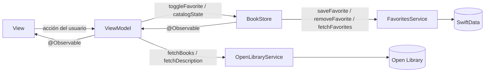

# Documentación técnica — BYbooKS

**Equipo 8:** Yael Alam González Prospero · Bryan Ricardo Laurrabaquio Ramírez

Este documento describe lo que **está implementado en la versión final** de la app. Los documentos de las prácticas 4 y 5 (`navigation-and-state.md`, `mvvm-investigacion-arquitectura.md`, `mvvm-refactorizacion.md`) conservan su contenido original, pero se actualizaron en la Práctica 8 para coincidir con esta versión.

---

## 1. Resumen

BYbooKS es una app iOS (SwiftUI) con tres pantallas: **Inicio** (catálogo y búsqueda), **Detalle** del libro y **Favoritos**. Consulta la API pública de Open Library y guarda los favoritos en el dispositivo con SwiftData. Está organizada con el patrón MVVM y un único `BookStore` como fuente de verdad compartida.

## 2. Arquitectura

### 2.1 Organización del proyecto

```
Proyecto Bry y Yael/
├── Models/        Datos de la app y estado compartido
├── Services/      Acceso a la red (Open Library) y a disco (SwiftData)
├── ViewModels/    Lógica de presentación de cada pantalla
├── Views/         Pantallas y subvistas (Components/)
└── Proyecto_Bry_y_YaelApp.swift   Punto de entrada: crea SwiftData y el BookStore
```

### 2.2 Responsabilidades de los componentes

| Capa | Archivo | Responsabilidad |
|---|---|---|
| Model | `Book` | Datos de un libro (`id` = clave de Open Library). Incluye `subtitle` ("año - género") y `coverURL(size:)` |
| Model | `LoadState` | Estado de una consulta: `idle`, `loading`, `content([Book])`, `empty`, `error(BookServiceError)` |
| Model | `BookStore` | Fuente única de verdad: estado del catálogo (`catalogState`) y favoritos. Se crea una vez en la `App` |
| Model | `FavoriteBook` | Registro persistente de SwiftData (`@Model`) |
| Model | `OpenLibraryDTO` | Estructuras `Decodable` de la respuesta de la API y su conversión a `Book` |
| Service | `OpenLibraryService` | Peticiones a Open Library, validación de respuesta y manejo de errores |
| Service | `FavoritesService` | Lectura, guardado y borrado de favoritos en SwiftData |
| ViewModel | `BookListViewModel` | Carga del catálogo, refresco aleatorio, texto de búsqueda, filtro local, búsqueda en la API, contador de favoritos |
| ViewModel | `BookDetailViewModel` | Estado de "guardado", texto del botón, descripción del libro (carga bajo demanda) |
| ViewModel | `FavoritesViewModel` | Lista de favoritos y si está vacía |
| View | `ContentView`, `SecondView`, `FavoritesView` | Pantallas Inicio, Detalle y Favoritos |
| View | `BookRow`, `SearchField` | Subvistas reutilizables. `BookRow.swift` también define la paleta de colores (`Color.app…`) |

### 2.3 Flujo de información



Las vistas no conocen la API ni SwiftData: solo leen propiedades del ViewModel. Las vistas se actualizan solas porque `BookStore` y los ViewModels son `@Observable`.

### 2.4 Navegación

`ContentView` contiene un `NavigationStack`. Se navega por valor: `NavigationLink(value: book)` y un único `navigationDestination(for: Book.self)` que abre `SecondView`. Ese mismo destino sirve para llegar al detalle desde Inicio, desde los resultados de búsqueda y desde Favoritos (que se abre con otro `NavigationLink` en el mismo stack).

## 3. Estado de la interfaz

- El catálogo vive en `BookStore.catalogState` (un `LoadState`); la lista `books` se deriva de él.
- Los resultados de buscar en Open Library viven en `BookListViewModel.searchState` (otro `LoadState`).
- Cada `LoadState` se representa en pantalla con su propio caso: cargando, contenido, vacío y error con *Reintentar*.
- El texto de búsqueda (`searchText`) está en el ViewModel y se enlaza al campo con `@Bindable`/`@Binding`.
- Si la respuesta de una búsqueda llega cuando el usuario ya cambió el texto, se ignora (`activeQuery`).

## 4. Networking

### 4.1 API utilizada

**Open Library** (pública, sin autenticación). Todas las peticiones son `GET` con `Accept: application/json`, `User-Agent: BYbooKS/1.0 (proyecto educativo)` y *timeout* de 15 s.

| Endpoint | Para qué | Parámetros |
|---|---|---|
| `https://openlibrary.org/search.json` | Catálogo, refresco aleatorio y búsqueda | `q` (texto o `subject:tema`), `fields=key,title,author_name,first_publish_year,subject,cover_i`, `limit=50`, `offset` (solo si es mayor que 0) |
| `https://openlibrary.org/works/{id}.json` | Descripción del libro en el detalle | La ruta usa la clave del libro (`/works/OL…W`) |
| `https://covers.openlibrary.org/b/id/{cover_i}-{M\|L}.jpg` | Portadas (`M` en listas, `L` en el detalle) | `cover_i` de la búsqueda |

### 4.2 Modelos de respuesta

| Respuesta de la API | Se decodifica en | Se convierte en |
|---|---|---|
| `{ "docs": [ … ] }` | `OpenLibrarySearchResponse` | — |
| Cada elemento de `docs` | `OpenLibraryDocument` (`key`, `title`, `author_name?`, `first_publish_year?`, `subject?`, `cover_i?`) | `Book` |
| Obra (`/works/…`) | `OpenLibraryWork` con `description` | Texto limpio (`cleanDescription`) |

Reglas de conversión a `Book`: `id = key`; si no hay autores se usa "Autor desconocido"; el género es el primer `subject` que esté en una lista de géneros conocidos (knownGenres); si ninguno coincide, queda sin género (null); año y portada son opcionales. La descripción de una obra puede venir como texto o como objeto `{ "value": … }`, y se recorta lo que sigue a una línea de guiones (`----------`).

### 4.3 Manejo de errores

`OpenLibraryService` traduce cada falla a un `BookServiceError`, que `LoadState.error` muestra en pantalla:

| Situación | Error |
|---|---|
| No se pudo armar la URL | `invalidURL` |
| `URLError` (sin red, tiempo agotado…) | `connectivity` |
| La respuesta no es HTTP | `invalidResponse` |
| Código HTTP fuera de 200–299 | `httpStatus(código)` |
| JSON que no se puede decodificar | `decoding` |
| Cualquier otro error | `unknown` |

Las cancelaciones (`CancellationError` o `URLError.cancelled`) no se tratan como error: el estado vuelve a `idle`. `fetchDescription` nunca lanza error: si falla, devuelve texto vacío y la interfaz muestra "Descripción no disponible.".

### 4.4 Comportamiento del catálogo

- **Al iniciar:** consulta `subject:classics` (hasta 50 libros) y muestra 10 al azar. `loadIfNeeded()` evita descargar de nuevo al volver a la pantalla.
- **Al jalar la lista:** elige un tema al azar de `randomSubjects` (distinto del anterior) y una posición al azar (`offset` entre 0 y 999). Si esa posición no devuelve libros, pide desde 0. Si falla, se conservan los libros que ya se ven.
- **Búsqueda:** mientras se escribe se filtra localmente por título o autor sobre los libros ya descargados; al presionar *Buscar* se consulta Open Library.

## 5. Persistencia

- **Mecanismo:** SwiftData. El `ModelContainer` se crea en `Proyecto_Bry_y_YaelApp` con `isStoredInMemoryOnly: false` (se guarda en disco).
- **Qué se guarda:** únicamente los favoritos, como `FavoriteBook`: `bookID`, `title`, `author`, `year` (texto), `genre` (texto) y `coverID`.
- **Qué no se guarda:** la descripción, las portadas ni el catálogo. Un favorito se reconstruye con `toBook()` sin consultar la red.
- **Sin duplicados:** `saveFavorite` busca por `bookID` antes de insertar.
- **Identidad:** un libro es favorito si coincide su `id` (clave de Open Library), no su título.
- **Flujo:** `BookStore.toggleFavorite` llama a `FavoritesService` y vuelve a leer la lista; las tres pantallas ven el mismo dato.

## 6. Pruebas

Se ejecutan con ⌘U en Xcode. Hay 30 pruebas con XCTest y 15 con Swift Testing. Ninguna usa la red real ni el disco real.

| Archivo | Qué cubre |
|---|---|
| `OpenLibraryServiceTests` | Decodificación y mapeo de libros, campos faltantes, respuesta vacía, error HTTP, de decodificación y de conectividad; estados del ViewModel (contenido, vacío, error, reintento, `loadIfNeeded`); búsqueda en Open Library; presencia o ausencia de `offset` en la URL |
| `FavoritesServiceTests` | `FavoritesService` real sobre SwiftData **en memoria**: guardar, no duplicar, quitar, quitar uno inexistente, persistir entre contextos, mismo título con distinto `id` |
| `BookStoreFavoritesTests` | `BookStore` con un servicio de favoritos falso: carga inicial, alternar, falla del servicio, identidad por `id`, contador |
| `Proyecto_Bry_y_YaelTests` | `Book.subtitle`, conversión a favorito, filtro de búsqueda, contador, `BookDetailViewModel` y `FavoritesViewModel` |
| `Proyecto_Bry_y_YaelUITests` | Solo la plantilla de Xcode (lanzar la app); sin casos propios |

Para evitar la red, `OpenLibraryService` recibe un `HTTPClient` (protocolo) y los ViewModels reciben un `BookServicing`; en pruebas se sustituyen por versiones falsas.

## 7. Decisiones técnicas

| Decisión | Motivo |
|---|---|
| MVVM con un ViewModel por pantalla | Mantener las vistas cortas y poder probar la lógica sin abrir la interfaz |
| `BookStore` como única fuente de verdad, creado una vez en la `App` | Evitar copias de los favoritos que se desincronicen entre pantallas |
| El `BookStore` se entrega por `init` y no por `@Environment` | Los ViewModels lo necesitan al crearse, y `@Environment` no está disponible en el `init` de una vista |
| Servicios detrás de protocolos (`HTTPClient`, `BookServicing`, `FavoritesServiceProtocol`) | Sustituirlos por falsos en las pruebas |
| `LoadState` como enum | Un solo valor describe en qué estado está una consulta, y la vista cubre cada caso |
| `Book.id` es la clave de Open Library | Antes se generaba un `UUID` nuevo en cada ejecución y los favoritos se perdían; con la clave de la API son estables |
| La descripción se pide aparte, solo al abrir el detalle | El endpoint de búsqueda no la incluye, y así se evita pedirla para libros que nunca se abren |
| Los favoritos guardan un resumen del libro, no solo su ID | Se pueden mostrar sin conexión y sin depender de que el libro vuelva a salir en una búsqueda |
| `year` y `genre` se guardan como texto en `FavoriteBook` | El esquema de SwiftData no cambia y los favoritos ya guardados siguen siendo válidos |
| Paleta de colores y tema claro fijos (`Color.app…`, `.preferredColorScheme(.light)`) | Que la interfaz se vea igual con el sistema en modo oscuro; los colores se cambian en un solo lugar |
| Sin librerías de terceros | Menos dependencias y un proyecto que abre sin pasos extra |

## 8. Limitaciones conocidas

**Funcionalidad**

- **Sin conexión:** los favoritos muestran título, autor, año y género, pero no portada, y su descripción no se carga.
- **Quitar favoritos:** solo se puede desde el detalle. `FavoritesViewModel.removeFavorite` existe y está probado, pero ninguna vista lo usa (no hay deslizar para borrar en Favoritos).
- **Búsqueda:** trae como máximo 50 resultados y no tiene paginación. El filtro local solo ve los libros descargados del tema actual.
- **Género y año:** Open Library no tiene un campo de género, solo etiquetas; la app muestra la primera que esté en su lista de géneros conocidos, y si no hay ninguna no muestra género y el año es el de la primera publicación, no el de la edición.
- **Refresco aleatorio:** si falla (por ejemplo, sin internet) no muestra ningún aviso; se quedan los libros anteriores.
- **Idioma:** los textos están solo en español.

**Interfaz**

- Las portadas tienen tamaño fijo (60×80 en listas y 120×170 en el detalle), por lo que no escalan con Dynamic Type.
- Se fuerza el tema claro.
- Los wireframes de `docs/wireframes/` son el diseño inicial (con pestañas) y no coinciden con la interfaz final.

**Código**

- `ContentView` y `SecondView` conservan su nombre original; en la práctica 5 se planteó renombrarlas a `BookListView` y `BookDetailView` (pendiente en [`mvvm-refactorizacion.md`](mvvm-refactorizacion.md#4-pendientes-estado-actual)).
- Los ViewModels de Favoritos y de Detalle se crean dentro de `body` y de `navigationDestination`, por lo que se recrean al actualizarse la vista.
- La paleta de colores está definida en el archivo `Theme.swift` en la sub carpeta Components de la carpeta Views.
- Los errores de SwiftData solo se escriben en consola (`print`); si el `ModelContainer` no se puede crear al iniciar, la app termina con `fatalError`.
- Las pruebas de interfaz (`UITests`) son la plantilla de Xcode.
- Versión mínima de iOS: 26.5.
