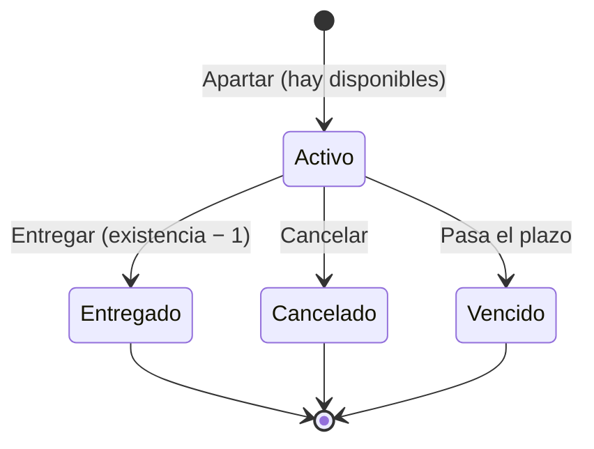

# Módulo de apartados (piloto)

**Equipo 8:** Yael Alam González Prospero · Bryan Ricardo Laurrabaquio Ramírez

Este documento describe el módulo de apartados que se agregó a BYbooKS a partir de la presentación del proyecto
(*Catálogo y apartados para una librería de barrio*). Lo implementado está en las secciones 1 a 8; la sección 9
indica qué metas de la presentación se pueden comprobar con el código y cuáles no.

## 1. Contexto y alcance

**Caso (simulado):** *Página de Barrio*, una librería de un solo local en la Ciudad de México que hoy lleva sus
apartados con mensajes y notas sueltas. El riesgo es que dos vendedores prometan el mismo último ejemplar.
**Meta:** catálogo + inventario + folio en un solo flujo.

| Dentro del piloto | Fuera del piloto |
|---|---|
| Inventario local: existencia física por libro | Pagos |
| Folios: apartar, entregar, cancelar o vencer | Notificaciones |
| Perfiles: vendedor y encargada | Sincronización entre dispositivos |
| Disponibilidad visible en la búsqueda y en el detalle | Inicio de sesión real |

## 2. Perfiles y permisos

| Perfil | Puede |
|---|---|
| **Vendedor** | Buscar, apartar, entregar y cancelar folios, consultar el inventario |
| **Encargada** | Todo lo anterior y además **ajustar las existencias** |

El perfil se elige en la pestaña *Apartados* (menú de la barra superior). La app siempre inicia como **vendedor**,
el perfil con menos permisos. El permiso se valida en `ReservationStore`, no solo escondiendo botones.

> Los perfiles son un selector, no una cuenta con contraseña: cualquiera que tenga la app puede cambiarse a
> encargada. Sirven para separar funciones en el piloto; un despliegue real necesitaría autenticación.

## 3. Reglas

| # | Regla (presentación) | Implementación | Pruebas |
|---|---|---|---|
| 1 | **Disponibles = Existencia física − Apartados activos** | `StockSummary.available` | `StockRulesTests`: fórmula y matriz existencia × apartados |
| 2 | **Búsqueda:** muestra el stock del libro correcto | `BookRow` (etiqueta *Disponibles: N* o *Sin stock*) y `StockSection` en el detalle | `StockRulesTests`, `ReservationViewModelTests` |
| 3 | **Último ejemplar:** dos solicitudes → un solo folio | `ReservationStore.reserve`: revisa el stock y crea el folio en una sola operación del MainActor | `elUltimoEjemplarSoloSeApartaUnaVez`, `variasSolicitudesSimultaneasPorElUltimoEjemplarCreanUnSoloFolio` |
| 4 | **Entrega:** cierra el folio y baja 1 unidad | `ReservationStore.deliver` (guarda folio y existencia juntos) | `entregarBajaUnaUnidadYNoCambiaLosDisponibles` y relacionadas |
| 5 | **Cancelar o vencer:** el libro vuelve a estar disponible | `ReservationStore.cancel` y `expireOverdue` | `cancelarLiberaElEjemplar`, `unFolioVencidoLiberaElEjemplar` y relacionadas |
| 6 | **Permisos:** solo la encargada ajusta existencias | `UserRole.canAdjustStock` + `ReservationStore.setExistence` | `ReservationPermissionsTests` |

Reglas adicionales para que el inventario no quede inconsistente: la existencia no puede ser negativa ni quedar
por debajo de los apartados activos; el nombre del cliente es obligatorio; los folios no se reutilizan; un folio
cerrado (entregado, cancelado o vencido) no se puede entregar ni cancelar otra vez.

## 4. Estados de un folio

Solo un folio **activo** cuenta como apartado. El folio se muestra como `#001`, `#002`…

El vencimiento se marca (`expireOverdue`) al abrir la app, al abrir la pestaña *Apartados*, al volver a la app y
antes de cada operación. No hay un proceso en segundo plano.

## 5. Cómo se usa (guion de la demostración)

1. **Perfil Encargada** (pestaña *Apartados*, menú de la barra superior).
2. En *Libros*, abrir un libro. En *Disponibilidad en el local*, subir la **existencia física** a 1. El libro queda
   registrado en el inventario y su tarjeta muestra *Disponibles: 1*.
3. **Perfil Vendedor.** En el detalle, tocar **Apartar**, escribir el cliente → **Folio #001**. La tarjeta pasa a
   *Sin stock* y el botón *Apartar* se deshabilita.
4. En *Apartados → Folios*, **Entregar** (pide confirmación): el folio pasa a *Entregado* y la existencia baja a 0.
   O **Cancelar**: el ejemplar vuelve a estar disponible.
5. En *Apartados → Inventario* se ve la existencia, los apartados activos y los disponibles de cada libro.
6. Favoritos sigue funcionando como antes: guardar un libro, cerrar la app y abrirla de nuevo.

En un solo dispositivo, el botón *Apartar* ya está deshabilitado cuando no hay disponibles. Que la segunda solicitud
de un último ejemplar se rechace aunque llegue "al mismo tiempo" se demuestra con la prueba de solicitudes
simultáneas, no desde la interfaz.

## 6. Arquitectura del módulo

Sigue el mismo MVVM del resto de la app: `ReservationStore` es la fuente única de verdad (como `BookStore`) y las
reglas viven ahí; los ViewModels preparan textos y listas; las vistas solo dibujan.

| Capa | Archivo | Responsabilidad |
|---|---|---|
| Model | `InventoryItem`, `Reservation`, `ReservationStatus`, `ReservationPolicy`, `StockSummary`, `BookAvailability`, `UserRole`, `ReservationError` | Datos, estados y reglas básicas (fórmula, permisos por perfil) |
| Model | `ReservationStore` | Inventario y folios; apartar, entregar, cancelar, vencer y ajustar existencias |
| Model | `ProfileStore` | Perfil activo (no se guarda en disco) |
| Service | `ReservationRepositoryProtocol`, `InMemoryReservationRepository`, `SwiftDataReservationRepository` | Almacenamiento detrás de un protocolo, igual que los favoritos |
| ViewModel | `BookStockViewModel`, `ReservationsViewModel`, `InventoryViewModel` | Detalle del libro, lista de folios e inventario |
| View | `RootView` | Raíz con dos pestañas: *Libros* y *Apartados*; inyecta el store y el perfil en el entorno |
| View | `ReservationsView` | Folios e inventario, con confirmación antes de entregar o cancelar |
| View | `StockSection`, `NewReservationSheet`, `ReservationRow`, `InventoryCard`, `AvailabilityChip`, `ProfileMenu` | Subvistas |

Cambios en código existente (mínimos): `Proyecto_Bry_y_YaelApp` (esquema, tiendas y `RootView`), `BookRow` (etiqueta
de disponibilidad, opcional) y `SecondView` (una línea: `StockSection`). `ContentView` no cambia: es la pestaña
*Libros*.

**Decisiones**

| Decisión | Motivo |
|---|---|
| El inventario usa `Book.id` (clave de la obra de Open Library) | Es el mismo identificador de los favoritos y de la búsqueda, así que el stock se muestra en el libro correcto |
| Las reglas están en `ReservationStore`, no en las vistas | Se prueban sin interfaz y no se repiten |
| Cada operación es síncrona y corre en el MainActor | Revisar el stock y crear el folio no se pueden intercalar con otra solicitud |
| El repositorio trabaja con structs de la app, no con registros de SwiftData | La lógica se prueba sin disco |
| `save(items:reservations:)` guarda todo en una sola operación | Una entrega no puede dejar el folio cerrado sin haber bajado la existencia |
| `BookRow` y `StockSection` leen el store del entorno (opcional) | No cambian sus inicializadores y siguen funcionando en vistas previas sin el módulo |

## 7. Persistencia

- Dos modelos nuevos de SwiftData: `InventoryRecord` (libro y existencia) y `ReservationRecord` (folio, cliente,
  perfil, estado y fechas). Los enums se guardan como texto.
- `FavoriteBook` no cambia. Los modelos nuevos se agregan al esquema en `Proyecto_Bry_y_YaelApp`.
- El perfil activo **no** se guarda.
- **Pendiente de comprobar en un iPhone con favoritos ya guardados:** que SwiftData agregue los modelos nuevos al
  almacén existente sin perder los favoritos (agregar modelos es un cambio compatible, pero no se pudo probar aquí).

## 8. Supuestos y limitaciones

**Supuestos que el equipo debe confirmar**

| Supuesto | Dónde cambiarlo |
|---|---|
| Un apartado vence a los **3 días**. La presentación no indica el plazo | `ReservationPolicy.standard` |
| El inventario es por **libro** (clave de la obra), no por edición concreta: la app aún no distingue ediciones | `InventoryItem.bookID` |
| Entregar y cancelar los pueden hacer ambos perfiles; la encargada es la única que corrige existencias | `ReservationStore` |
| Del cliente solo se guarda el nombre | `Reservation.customerName` |

**Limitaciones**

- El inventario y los folios viven en **un solo dispositivo**: no se sincronizan entre teléfonos. Dos vendedores en
  dos dispositivos distintos no comparten el stock; eso requeriría un servidor.
- Sin inicio de sesión (ver sección 2).
- Sin pagos ni notificaciones (fuera del piloto).
- El vencimiento se marca al abrir la app o la pantalla, no en segundo plano.
- No hay historial de ajustes de existencia ni se puede editar un folio.
- No se puede quitar un libro del inventario; se deja en existencia 0 (*Sin stock*).
- Las capturas del README son anteriores a este módulo y no muestran la pestaña *Apartados*.

## 9. Metas de la presentación y qué se puede comprobar

La presentación define metas de calidad (GQM, OKR, ISO/IEC 25010) y aclara que son *metas propuestas: la primera
ejecución del piloto fija la línea base*. Esta tabla separa lo que el código permite comprobar de lo que no.

| Meta de la presentación | Cómo se comprueba | Estado |
|---|---|---|
| Adecuación funcional: 5 de 5 criterios aprobados | Las reglas de la sección 3 (los criterios no se listan en la presentación; se tomaron como las cinco reglas de la diapositiva *Reglas*) | Cubiertas por pruebas automáticas; falta que la encargada las apruebe |
| Confiabilidad: 0 fallos en 60 pruebas de stock | `StockRulesTests`: 87 casos | 0 fallos al ejecutarlas en Linux; pendiente repetirlas en Xcode |
| Seguridad: 0 fallos / 8 | `ReservationPermissionsTests`: 12 casos de permisos | 0 fallos en Linux; recordar que los perfiles no tienen autenticación |
| Interacción: 9/10 recorridos sin ayuda, en ≤ 120 s | Prueba con personas | **No medido** |
| Desempeño: p95 ≤ 800 ms | Medición en dispositivo | **No medido** (las operaciones son locales, sin red, pero no se midieron) |
| 100 % de requisitos preparados, 90 % de hitos a tiempo, 0 defectos críticos abiertos | Seguimiento del proyecto | **No medible desde el código** |

MoProSoft, CMMI, el cronograma y la gestión del proyecto se documentan en la presentación; este repositorio solo
cubre la parte de software.

## 10. Pruebas del módulo

| Archivo | Tipo | Funciones | Casos | Qué cubre |
|---|---|---|---|---|
| `StockRulesTests` | Swift Testing | 28 | 87 | Fórmula, stock por libro, último ejemplar (incluye solicitudes simultáneas), entrega, cancelar, vencimiento, folios, ajuste de existencias, conservar datos al reabrir |
| `ReservationPermissionsTests` | Swift Testing | 10 | 12 | Permisos por perfil en el store y en los ViewModels |
| `ReservationViewModelTests` | Swift Testing | 17 | 17 | Textos y listas del detalle, folios e inventario |
| `ReservationPersistenceTests` | XCTest + SwiftData | 7 | 7 | Repositorio real de SwiftData en memoria, entrega atómica, convivencia con `FavoriteBook` |

Se ejecutan con **⌘U** en Xcode. Ninguna usa la red.

**Ejecutado al preparar esta rama (Linux, Swift 6.2.3, solo la lógica; sin SwiftUI ni SwiftData):** las 55 funciones
nuevas de Swift Testing (116 casos) y las 15 originales pasan, y 24 de las 31 pruebas XCTest originales también
(las 7 de `FavoritesServiceTests` usan SwiftData y no se pueden ejecutar en Linux). Además se rompieron a propósito
tres reglas en una copia (fórmula, permisos y entrega) y las pruebas fallaron en cada caso, así que sí detectan
errores.

**No ejecutado (requiere Xcode):** la compilación de las vistas SwiftUI, `ReservationPersistenceTests`, las pruebas
de interfaz, VoiceOver y la migración con favoritos ya guardados.
