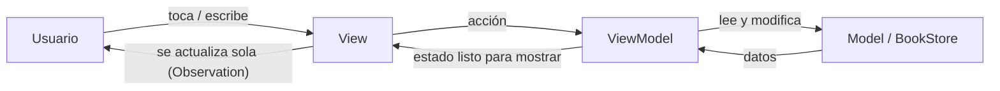

# Investigación: separación de responsabilidades con MVVM — AJBooks

**Integrantes:**

· Yael Alam González Prospero
· Bryan Ricardo Laurrabaquio Ramirez

----------------------------------------------------------------------------------------------------------

## 1. ¿Por qué conviene separar responsabilidades?

Como no sabemos si le vamos a agregar mas pantallas o lógica a AJBooks (tiene solo tres pantallas), cada pantalla nueva agrega más reglas: filtros, mensajes, estados, si todo vive dentro de las vistas, cada cambio obliga a leer y tocar mucho código mezclado y el separar responsabilidades significa que cada parte del código va a tener un solo trabajo, esto hace que cada pantalla de la app pueda leer, cambiar y probar sin afectar a las demás.

Las vistas de la app de AJBooks hacen dos trabajos a la vez: dibujar la interfaz y decidir qué datos mostrar, por ejemplo, `ContentView` filtra los libros y decide cuándo mostrar el mensaje de "no se encontraron libros", y `SecondView` decide el texto del botón según el estado de "guardado".

### 1.1 Diferencia entre código de interfaz, de datos y de lógica

| Tipo de código | Qué es | Ejemplos en AJBooks |
|---|---|---|
| **Interfaz** | Cómo se ve la pantalla y cómo responde al toque | `VStack`, `Text`, `Button`, colores, `NavigationLink`, `frame` |
| **Datos** | La información de la app y su forma | `struct Book`, la lista `books`, `favoriteIDs` |
| **Lógica** | Las decisiones y reglas que se aplican sobre los datos | Filtrar libros por búsqueda, alternar un favorito, decidir qué mensaje mostrar, armar el texto `año - género` |

La interfaz muestra, los datos describen y la lógica decide. El problema aparece cuando las tres cosas están en el mismo archivo.

### 1.2 Problemas cuando una View concentra demasiadas responsabilidades

1. **Vistas largas y difíciles de leer.** El diseño (`VStack`, `padding`, colores) queda mezclado con `if` y `filter`, y cuesta distinguir qué parte es qué. Ejemplo: el filtro de búsqueda dentro de `ContentView`.
2. **La lógica es difícil de probar.** Para comprobar que el filtro funciona hay que abrir la app y escribir en el campo, porque la regla está atada a la pantalla y no se puede probar sola.
3. **Lógica repetida o dispersa.** Si dos pantallas necesitan la misma regla y cada una la escribe por su cuenta, pueden quedar distintas y habrá que corregir varios lugares. Ejemplo: el formato `año - género` se arma en una vista, y otra pantalla podría repetirlo.
4. **Cambios riesgosos.** Cambiar el diseño puede romper una regla sin querer, y cambiar una regla obliga a tocar la vista.
5. **Más conflictos al trabajar en equipo.** Si dos integrantes editan la misma vista porque ahí está todo, git genera conflictos al unir los cambios.

MVVM ayuda a resolver estos cinco puntos al darle a la lógica de presentación un lugar propio: el ViewModel.

## 2. Los tres componentes

| Componente | Responsabilidad | Qué NO debe hacer |
|---|---|---|
| **Model** | Representar los datos y sus reglas básicas (qué es un libro, qué es un favorito) | Saber cómo se dibuja nada |
| **View** | Mostrar el estado actual y avisar de las acciones del usuario (toques, texto escrito) | Filtrar, ordenar, decidir reglas |
| **ViewModel** | Preparar los datos para la vista y reaccionar a las acciones del usuario | Importar componentes visuales (`Text`, `Button`, etc.) |

### Flujo de información



La vista observa al ViewModel; cuando cambia su estado, SwiftUI vuelve a dibujar, la vista nunca habla directamente con el Model.

En el patrón MVVM, el ViewModel se encarga de la lógica de presentación y de pasar a la vista los datos del Model ya preparados. Con la macro `@Observable`, SwiftUI actualiza las vistas que leen esos datos cuando cambian.

## 3. Análisis del proyecto actual

### Qué hay hoy

Hoy todos los archivos están juntos en la misma carpeta del proyecto. No se han separado en carpetas por rol todavía, esa organización forma parte de la propuesta e investigación y se haría en la etapa de implementación.

| Archivo | Rol actual |
|---|---|
| `Book.swift` | Datos de un libro |
| `BookStore.swift` | **Estado compartido**: lista de libros + favoritos (mezcla datos y reglas) |
| `ContentView.swift` | Vista de Inicio **+ lógica de filtrado** |
| `SecondView.swift` | Vista de Detalle **+ decisión de “guardado”** |
| `FavoritesView.swift` | Vista de Favoritos |
| `BookRow.swift`, `SearchField.swift` | Subvistas reutilizables (solo UI) |

### Lógica que debería salir de las vistas

El criterio que usamos es este: si algo es una decisión o una regla sobre los datos, debe salir de la vista y si solo describe cómo se dibuja algo en pantalla, se queda en la vista.

| Lógica | Dónde está hoy | A dónde debería ir | Por qué debería salir |
|---|---|---|---|
| Filtrar libros según `searchText` (`filteredBooks`) | `ContentView` | ViewModel de Inicio | Es una regla sobre los datos, no una forma de dibujar, en el ViewModel se puede probar sin abrir la pantalla y la vista solo recibe la lista ya filtrada. |
| Decidir si hay que mostrar “no se encontraron libros” | `ContentView` | ViewModel de Inicio (propiedad como `noResults`) | Depende del resultado del filtro, si el ViewModel ya lo calcula, la vista solo muestra u oculta el texto y no repite la cuenta. |
| Armar el texto `year + " - " + genre` | `BookRow` | ViewModel o un dato calculado del Model | Es formato de datos, si se arma en un solo lugar, todas las pantallas muestran el mismo texto y si el formato cambia, se corrige una sola vez. |
| Calcular cuántos favoritos hay para el botón | `ContentView` | ViewModel de Inicio | Es un dato que se obtiene del estado compartido. La vista no debería contar, solo mostrar el número que le dan. |
| Saber si un libro está guardado (`isFavorite`) y cambiarlo (`toggleFavorite`) | `SecondView` llama al `BookStore` | ViewModel de Detalle | Es la regla de los favoritos. El ViewModel la maneja y la vista solo avisa que se tocó el botón, sin saber cómo se guarda. |
| Decidir el texto del botón (“Guardar” / “Guardado”) y su etiqueta de VoiceOver | `SecondView` | ViewModel de Detalle | El texto depende del estado de “guardado”, es decir, es lógica de presentación, que es justo el trabajo del ViewModel. |
| Mensaje de “aún no hay favoritos” | `FavoritesView` | ViewModel de Favoritos | Depende de si la lista está vacía, el ViewModel puede exponer `isEmpty` y la vista solo decide cómo mostrarlo. |

Lo que se queda en la vista: layout (`VStack`, `HStack`, `frame`), colores, modifiers, `NavigationLink`/`navigationDestination` y el `@State` de interfaz puro.

**Por qué se queda en la vista:**

- **Layout, colores y modifiers:** son la parte de interfaz, es decir, cómo se ve la pantalla. No toman decisiones sobre los datos, así que no hay nada que separar.
- **`NavigationLink` y `navigationDestination`:** conectan una pantalla con otra y el destino es una vista, por eso pertenecen a la capa de interfaz.
- **`@State` de interfaz puro:** es estado que solo afecta cómo se ve una pantalla y que ninguna otra parte de la app necesita. No es un dato de la app, por lo que no hace falta llevarlo al ViewModel.

## 4. Propuesta de organización

### Resumen de la propuesta inicial

| Pregunta | Respuesta | Por qué |
|---|---|---|
| **¿Qué elementos corresponden al Model?** | `Book` (los datos de un libro) y `BookStore` (la lista de libros y los favoritos, como fuente única de verdad) | `Book` solo describe datos y `BookStore` guarda la lista y los favoritos. Ninguno sabe cómo se dibuja nada, que es lo que define al Model. `BookStore` se queda aquí porque es la fuente única de verdad que comparten varias pantallas. |
| **¿Qué elementos corresponden a las View?** | `ContentView`, `SecondView`, `FavoritesView`, `BookRow` y `SearchField` | Cada una se dedica a mostrar algo en pantalla (pantallas completas o piezas reutilizables) y a avisar de los toques del usuario, sin tomar decisiones sobre los datos. |
| **¿Qué responsabilidades podrían vivir fuera de las View?** | Filtrar libros por búsqueda, decidir cuándo mostrar el mensaje de "sin resultados" o "sin favoritos", calcular el contador de favoritos, saber si un libro está guardado y alternarlo, decidir el texto del botón y armar el texto `año - género` | Son decisiones y cálculos sobre los datos, no dibujo. Sacarlas hace las vistas más cortas y permite probar la lógica sin abrir la interfaz. |
| **¿Qué ViewModel podrían ser necesarios?** | `BookListViewModel` (Inicio), `BookDetailViewModel` (Detalle) y `FavoritesViewModel` (Favoritos) | Cada pantalla tiene necesidades distintas: búsqueda en Inicio, estado de “guardado” en Detalle y la lista en Favoritos. Un ViewModel por pantalla evita uno gigante que concentre todo, que sería el mismo problema de una View sobrecargada. |
| **¿Qué responsabilidades tendría cada uno?** | En la tabla "Responsabilidad de cada ViewModel" más abajo | Se explican ahí, con su porqué. |

### Estructura de carpetas

Esta estructura es la propuesta de la arquitectura para la siguiente etapa:

```
Proyecto Bry y Yael/
├── Models/
│   ├── Book.swift
│   └── BookStore.swift            ← fuente única de datos (se mantiene)
├── ViewModels/
│   ├── BookListViewModel.swift    ← Inicio
│   ├── BookDetailViewModel.swift  ← Detalle
│   └── FavoritesViewModel.swift   ← Favoritos
└── Views/
    ├── ContentView.swift
    ├── SecondView.swift
    ├── FavoritesView.swift
    └── Components/ (BookRow, SearchField)
```

### Responsabilidad de cada ViewModel

| ViewModel | Estado que expone | Acciones | Lo usa | Por qué tiene estas responsabilidades |
|---|---|---|---|---|
| `BookListViewModel` | `searchText`, `filteredBooks`, `noResults`, `favoritesCount` | actualizar búsqueda | `ContentView` | Inicio es la única pantalla con búsqueda, así que el texto y el filtrado viven aquí. También expone `noResults` y `favoritesCount` para que la vista solo muestre esos datos. |
| `BookDetailViewModel` | `book`, `isSaved`, `buttonTitle` | `toggleSaved()` | `SecondView` | Detalle trabaja con un solo libro y necesita saber si está guardado. La acción de guardar o quitar y el texto del botón dependen de ese mismo estado, por eso se concentran aquí. |
| `FavoritesViewModel` | `favorites`, `isEmpty` | quitar favorito | `FavoritesView` | Favoritos solo necesita la lista de favoritos y saber si está vacía, mantenerlo separado evita que Inicio o Detalle carguen con lógica que no usan. |

### Qué pasa con `BookStore`

`BookStore` se mantiene como la fuente única de verdad (Single Source of Truth), los tres ViewModels reciben el mismo `BookStore` y leen/modifican datos a través de él, así se evita que cada ViewModel tenga su propia copia de los favoritos y se desincronicen. La documentación de Apple indica que un objeto de datos observable puede crearse una sola vez en la `App` de nivel superior para usarlo en toda la aplicación, que es justo lo que hace hoy el proyecto.


## 5. Dudas y cosas por resolver antes de implementar

1. **Cómo crear el ViewModel con el `BookStore` del `@Environment`**: el `@Environment` no está disponible en el `init` de la vista, hay que decidir si el ViewModel se crea en la raíz o se le pasa el store después.
2. **`@Bindable`** pasa a ser necesario para enlazar `searchText` del ViewModel con el `TextField` (en el MVP actual no hacía falta).
3. **¿Un ViewModel por pantalla o uno solo?** Se propone uno por pantalla para que cada uno tenga pocas responsabilidades.
4. **Persistencia** (favoritos al cerrar la app) sigue fuera de alcance.
5. **¿`BookStore` es parte del Model o es un ViewModel?** En esta propuesta se queda en la capa Model porque guarda los datos y sus reglas básicas y lo comparten varias pantallas; los ViewModels lo usan para preparar lo que cada vista necesita, pero es una decisión que conviene confirmar al implementar.

## 6. Ventajas esperadas

- Vistas más cortas y fáciles de leer.
- La lógica (filtrado, favoritos) se puede probar sin abrir la interfaz.
- Cambiar el diseño no rompe las reglas, y cambiar las reglas no rompe el diseño.
- Cada integrante del equipo puede trabajar en una pantalla sin pisar el trabajo del otro.

## 7. Referencias

**Documentación oficial de Apple**

1. Apple Developer Documentation. *Managing model data in your app* (SwiftUI). Explica cómo crear un modelo de datos observable y compartirlo entre las vistas, incluso creándolo en la `App`.
   https://developer.apple.com/documentation/swiftui/managing-model-data-in-your-app
2. Apple Developer Documentation. *Observation*. Describe la macro `@Observable` y cómo se usa para que la interfaz se actualice cuando cambian los datos.
   https://developer.apple.com/documentation/observation
3. Apple Developer Documentation. *NavigationStack* (SwiftUI). Explica la pila de navegación y cómo se combina con `NavigationLink` y `navigationDestination`.
   https://developer.apple.com/documentation/swiftui/navigationstack
4. Apple Developer Documentation. *navigationDestination(for:destination:)*. Asocia una pantalla de destino con un tipo de dato; el tipo debe ser `Hashable` y el modificador no debe ir dentro de contenedores "lazy" como `List` o `LazyVStack`.
   https://developer.apple.com/documentation/swiftui/view/navigationdestination(for:destination:)
5. Apple Developer Documentation. *NavigationLink* (SwiftUI). Describe los enlaces que presentan una vista de destino o envían un valor a la pila.
   https://developer.apple.com/documentation/swiftui/navigationlink

**Recurso sobre MVVM (no oficial)**

6. Hudson, P. *Introducing MVVM into your SwiftUI project*, en *Hacking with Swift*. Muestra cómo mover la lógica de una vista a un ViewModel con `@Observable`, de modo que la vista presente datos y el ViewModel los administre.
   https://www.hackingwithswift.com/books/ios-swiftui/introducing-mvvm-into-your-swiftui-project
