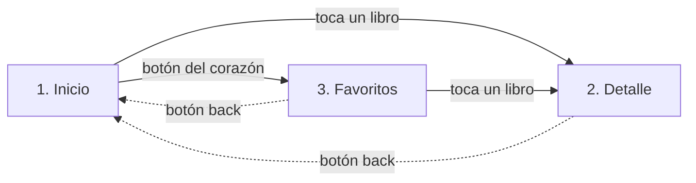

# Navegación y organización del estado: BYbooKS

> **Actualizado en la Práctica 8** para describir la versión final. El diseño original (Práctica 4) planteaba datos locales y una pantalla de Favoritos como propuesta; hoy la app consulta Open Library, guarda los favoritos con SwiftData y usa MVVM. Detalles técnicos en [`documentacion-tecnica.md`](documentacion-tecnica.md).

**Integrantes**

- Yael Alam González Prospero
- Bryan Ricardo Laurrabaquio Ramirez

---

## 0. Resumen del MVP

BYbooKS es una app para descubrir libros en tendencia, buscarlos por título o autor y ver su detalle. El usuario puede guardar los libros que le interesan, quitarlos de su lista de favoritos y consultarlos aunque cierre la app.

**Flujo principal:** abrir la app → ver la lista de libros → buscar (opcional) → entrar al detalle → guardar como favorito → consultar favoritos.

**Organización actual del código:**

| Carpeta / archivo | Contenido |
|---|---|
| `Models/` | `Book`, `BookStore` (estado compartido), `FavoriteBook` (SwiftData), `LoadState`, DTOs de Open Library |
| `Services/` | `OpenLibraryService` (red), `FavoritesService` (disco), `BookServiceError` |
| `ViewModels/` | `BookListViewModel`, `BookDetailViewModel`, `FavoritesViewModel` |
| `Views/` | `ContentView` (Inicio), `SecondView` (Detalle), `FavoritesView`, `Components/` (`BookRow`, `SearchField`) |
| `Proyecto_Bry_y_YaelApp.swift` | Punto de entrada: crea SwiftData y el `BookStore` |

---

## 1. Mapa de navegación

**Pantallas del MVP:**

| # | Pantalla | Archivo | Estado |
|---|---|---|---|
| 1 | Inicio: catálogo, búsqueda y resultados | `ContentView.swift` | Implementada |
| 2 | Detalle del libro | `SecondView.swift` | Implementada |
| 3 | Favoritos | `FavoritesView.swift` | Implementada |

La app no tiene barra de pestañas: la búsqueda está en Inicio y Favoritos se abre con el botón del corazón (que muestra el contador).

**Diagrama de flujo:**

Desde el detalle y desde Favoritos se regresa con el botón *back*.

---

## 2. Información por pantalla

### Pantalla 1 · Inicio

| Aspecto | Detalle |
|---|---|
| **Muestra** | Título, botón de favoritos con contador, campo de búsqueda y, por cada libro: portada, título, autor y "año - género" (si existen). También los estados de carga, sin resultados y error |
| **Recibe** | El estado del catálogo (`BookStore.catalogState`) y el resultado de la búsqueda (`searchState`), ambos como `LoadState` |
| **Modifica** | El texto de búsqueda. Al presionar *Buscar* lanza la consulta a Open Library; al jalar la lista pide otros libros al azar |
| **Necesita conservar** | El catálogo descargado y el texto de búsqueda, que se mantienen al ir al detalle y volver |

### Pantalla 2 · Detalle

| Aspecto | Detalle |
|---|---|
| **Muestra** | Portada, título, autor, botón Guardar/Guardado, descripción, año y género. Si falta un dato, muestra un texto de reemplazo |
| **Recibe** | El libro seleccionado |
| **Modifica** | Si el libro está guardado o no. Pide la descripción a Open Library al aparecer |
| **Necesita conservar** | El estado de favorito, que vive en el `BookStore` y por eso no se pierde al salir de la pantalla |

### Pantalla 3 · Favoritos

| Aspecto | Detalle |
|---|---|
| **Muestra** | Los libros guardados, o el mensaje "Aún no tienes libros favoritos" |
| **Recibe** | La lista de favoritos que prepara `FavoritesViewModel` |
| **Modifica** | Nada directamente: los libros se quitan desde su detalle |
| **Necesita conservar** | Los favoritos, que deben coincidir con lo que se ve en Inicio y Detalle y persistir al cerrar la app |

---

## 3. Organización del estado

**Single Source of Truth.** Cada dato tiene un solo dueño. Las demás vistas lo leen o lo editan a través de ese dueño, pero no guardan su propia copia.

### Estados identificados

| Estado | Dónde se usa | ¿Aplica al MVP? |
|---|---|---|
| Contenido | Lista y detalle | Sí |
| Selección | Libro elegido en la lista | Sí |
| Filtro | Texto de búsqueda | Sí |
| Favoritos | Detalle, Inicio y Favoritos | Sí |
| Loading | Carga del catálogo, de la búsqueda y de la descripción | Sí |
| Empty | Consulta correcta pero sin libros, o búsqueda sin coincidencias | Sí |
| Error | Falla de conexión, del servidor o al interpretar la respuesta | Sí |

### Dónde vive cada dato

| Dato | Dónde vive | Herramienta | Por qué |
|---|---|---|---|
| Texto de búsqueda | `BookListViewModel` | `@Observable` + `@Bindable` | Solo importa en Inicio; la vista lo enlaza al campo de texto |
| Catálogo remoto | `BookStore.catalogState` | `@Observable` (`LoadState`) | Un solo valor indica si está cargando, con contenido, vacío o con error |
| Resultados de búsqueda en Open Library | `BookListViewModel.searchState` | `@Observable` (`LoadState`) | Solo los usa Inicio |
| Favoritos | `BookStore` (los guarda `FavoritesService`) | `@Observable` + SwiftData | Los leen tres pantallas; con una sola fuente no se desincronizan, y SwiftData los conserva al cerrar la app |
| Acceso al `BookStore` | Se crea una vez en la `App` y se entrega por `init` | Inicializador | Los ViewModels lo necesitan al crearse, y `@Environment` no está disponible en el `init` de una vista |
| Libro seleccionado | Se envía al navegar | `navigationDestination(for: Book.self)` | Es información que se pasa entre pantallas, no estado que haya que guardar |
| Descripción del libro | `BookDetailViewModel` | `@Observable` | Se pide solo al abrir el detalle |

### Uso de `@Binding` y `@Bindable`

- **`@Binding`:** `SearchField` recibe el texto del padre y lo lee y escribe, en lugar de tener uno propio. Así no hay datos duplicados.
- **`@Bindable`:** `ContentView` lo usa para enlazar `searchText` del ViewModel con el campo de texto. Ya no es opcional como en el MVP inicial: se necesita porque el texto vive en un objeto observable.

### Qué se mantiene durante la navegación

- **Favoritos:** siempre, porque viven en el `BookStore` y en SwiftData, no en una vista.
- **Catálogo y texto de búsqueda:** `ContentView` es la raíz del stack y conserva su ViewModel, así que al volver del detalle la lista sigue como estaba.
- **Libro seleccionado:** solo mientras el detalle está en pantalla.

Cuando el usuario toca "Guardar", cambia el dato en el `BookStore` y SwiftUI actualiza la interfaz en Inicio, Detalle y Favoritos automáticamente.

---

## 4. Estrategia de navegación

Se usa `NavigationStack` con `NavigationLink` y `navigationDestination`.

| Desde | Hacia | Acción | Mecanismo |
|---|---|---|---|
| Inicio | Detalle | Toca un libro | `NavigationLink(value:)` + `navigationDestination(for: Book.self)` |
| Detalle | Inicio | Botón *back* | Automático con `NavigationStack` |
| Inicio | Favoritos | Botón del corazón | `NavigationLink(destination:)` |
| Favoritos | Detalle | Toca un libro | El mismo `navigationDestination` de Inicio |
| Detalle | Detalle | Guardar / Guardado | El botón modifica el dato del `BookStore` |

**Por qué esta opción:**

- Inicio no necesita saber cómo se construye el detalle: solo envía el libro elegido.
- El mismo destino sirve para llegar al detalle desde Inicio, desde los resultados de búsqueda y desde Favoritos, sin duplicar código.

**Limitación:** `FavoritesView` depende del `navigationDestination` definido en `ContentView`; funciona porque se abre dentro del mismo stack, pero es una dependencia implícita.

---

## 5. Cambios respecto al diseño original

| Problema detectado en la Práctica 4 | Cómo quedó |
|---|---|
| `saved` dentro de `SecondView` se reiniciaba al salir | El estado de favorito vive en `BookStore` y se persiste con SwiftData |
| Favoritos duplicados en potencia | Una sola fuente de verdad (`BookStore`) |
| `Book` y `books` dentro de `ContentView.swift` | `Book` está en `Models/`; los libros llegan de Open Library |
| `NavigationView` | `NavigationStack` |
| Sin pantalla para ver los favoritos | `FavoritesView`, abierta desde el botón del corazón |
